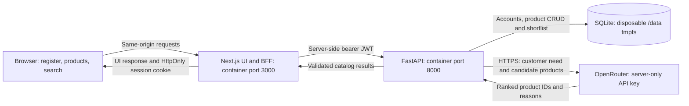

# AI Sales Support Hub

A protected product catalog and AI recommendation workspace for sales teams.

## Features

- FastAPI REST API with Swagger, username/password authentication and signed one-hour JWTs.
- Next.js TypeScript Web with registration, product CRUD, search and clear provider-error states.
- Registration uses Username, Password and Confirm password. Email is neither collected nor stored. Passwords use Argon2id hashing.
- Ten fictional demo products use the neutral Demo Sensors and Demo Automation brands.
- OpenRouter ranks a catalog shortlist. The backend resolves returned IDs against stored products and returns up to three suggestions. Missing/broken inference returns 503 AI_UNAVAILABLE.
- HttpOnly browser sessions, mutation Origin checks and backend bearer validation.

## Requirements

| Requirement | Docker deployment | Local source development |
|---|---|---|
| Git | Clone and update the repository | Required |
| Docker Engine and modern Compose (v2 or later) | Required; Compose must support `--wait` and `--wait-timeout` | Optional, unless running container E2E tests |
| Bash/POSIX shell, OpenSSL, curl and sed | Required for the commands below and URL/readiness reporting | Required for the setup commands |
| Python 3.12 and pip | Installed inside the API image; no host Python required | Required on the host |
| Node.js 22 and npm | Installed inside the Web image; no host Node.js required | Required on the host |
| Web browser | Required to use the application | Required |
| Network access | Image registry, npm and PyPI for the first build; outbound HTTPS to OpenRouter for live AI | Package installation and live AI |
| OpenRouter account, API key and available model | Required for live AI; registration, login and CRUD work without them | Same |

Use Linux, macOS, or Windows with WSL2 and Linux containers for these shell commands. Start Docker before deploying. [Docker's installation guide](https://docs.docker.com/compose/install/) covers Compose installation.

Check the installed tools:

```sh
git --version
docker version
docker compose version
openssl version
curl --version
```

## Quick start: one command

On a new checkout, this clones the repository, creates a private `.env` from the template with a generated JWT secret, builds and starts the containers, waits for readiness and prints the allocated URLs:

```sh
git clone https://github.com/ArthurMinovsky/ai-sales-support-hub.git && cd ai-sales-support-hub && (umask 077; { printf 'JWT_SECRET=%s\n' "$(openssl rand -hex 32)"; sed '/^JWT_SECRET=/d' .env.example; } > .env) && export COMPOSE_PROJECT_NAME=saleshub-implementation-check && docker compose up --build --force-recreate -d --wait --wait-timeout 180 && ./scripts/status.sh
```

This starts the Web and API without a provider key. To enable live recommendations, configure the key and model as described below, then run `./start` again.

Docker assigns unused host ports. Follow the printed Web URL; internal container ports remain Web **3000** and API **8000**. Register a new account before signing in. Registration uses a username of 3–100 letters/digits/underscores/dots/hyphens, a password of 10–128 characters and matching confirmation. Surrounding username whitespace is removed and names are compared in lowercase.

## Environment configuration

The tracked [`.env.example`](.env.example) is a safe template. The real `.env` belongs at the repository root and is ignored by Git. All values below are placeholders or non-secret defaults:

```dotenv
JWT_SECRET=REPLACE_WITH_LONG_RANDOM_SECRET_AT_LEAST_32_CHARACTERS
OPENROUTER_API_KEY=
OPENROUTER_MODEL=REPLACE_WITH_AVAILABLE_JSON_MODEL_ID
OPENROUTER_BASE_URL=https://openrouter.ai/api/v1/chat/completions
API_PORT=0
WEB_PORT=0
APP_ORIGIN=
```

| Variable | Purpose and required value |
|---|---|
| `JWT_SECRET` | Required to start the API. Use a generated random secret, at least 32 characters. `openssl rand -hex 32` generates a suitable value. Replace the placeholder. |
| `OPENROUTER_API_KEY` | Set your private OpenRouter key for live suggestions. Leave blank to use authentication and CRUD without AI. The key stays on the API server. |
| `OPENROUTER_MODEL` | Replace the placeholder with a currently available model ID that supports JSON object responses and is accessible to your account. Check pricing, credits and limits for that model. |
| `OPENROUTER_BASE_URL` | Keep the official HTTPS endpoint shown above for live operation. The isolated test overlay overrides it with the mock provider. |
| `API_PORT`, `WEB_PORT` | `0` requests dynamically allocated host ports. Set an available port number only if you need a stable mapping, for example behind a reverse proxy. |
| `APP_ORIGIN` | Leave blank for direct HTTP access on Docker's allocated port. For an HTTPS reverse proxy, set the exact public origin, such as `https://sales.example.com`, without a path or trailing slash. |

Compose supplies `DATABASE_URL=sqlite:////data/app.db` to the API and `BACKEND_INTERNAL_URL=http://api:8000` to the Web. These internal addresses do not change when Docker allocates different host ports.

Create an OpenRouter key and choose a model using the [OpenRouter quickstart](https://openrouter.ai/docs/quickstart) and [model catalog](https://openrouter.ai/models). The app requires JSON-ranking responses; model availability, pricing and free-model limits can change. Configuration alone does not verify a live request. Missing credentials, unavailable models, provider errors, timeouts or malformed responses produce `503 AI_UNAVAILABLE`.

Keep actual keys out of README snippets, screenshots and commits. Edit `.env` privately; changing the template does not change an existing `.env`.

## Step-by-step installation and Docker deployment

1. **Get the source:**

   ```sh
   git clone https://github.com/ArthurMinovsky/ai-sales-support-hub.git
   cd ai-sales-support-hub
   ```

2. **Create the environment file if one does not already exist:**

   ```sh
   test -e .env || (umask 077; { printf 'JWT_SECRET=%s\n' "$(openssl rand -hex 32)"; sed '/^JWT_SECRET=/d' .env.example; } > .env)
   ```

   This preserves an existing `.env`. Edit it manually to supply the OpenRouter key and selected model if you need live AI.

3. **Build, start and print URLs with one command:**

   ```sh
   export COMPOSE_PROJECT_NAME=saleshub-implementation-check && docker compose up --build --force-recreate -d --wait --wait-timeout 180 && ./scripts/status.sh
   ```

   From an existing configured checkout, `./start` performs the same build, fresh recreation, readiness wait and URL reporting.

4. **Use the application:** open the printed Web URL → Register → Sign in → Products to add/edit/delete records → Search to describe a customer's needs. Open the printed Swagger URL to inspect the API.

5. **Check or stop the stack:**

   ```sh
   docker compose -p saleshub-implementation-check ps
   docker compose -p saleshub-implementation-check logs --tail=100 api web
   ./scripts/status.sh
   docker compose -p saleshub-implementation-check down
   ```

   Stopping the API clears its disposable data. The commands above target the documented project; use the same project name if you override it.

### Deploying to another machine

Install the requirements, clone the repository there, create that machine's private `.env`, and run the same Docker command. The first build installs application dependencies inside the images. Host Python, Node.js, a separate database service and a local GPU are not required for Docker deployment.

For direct access from another device, use the Docker host's IP or hostname with the printed Web port and permit that port in the host firewall. The launcher prints `localhost` URLs for access on the host itself. Web and API host ports are published by Compose; on an external server, restrict API/Swagger access to the intended users.

For HTTPS, terminate TLS at your configured reverse proxy, route the public site to the Web's host port, preserve its request Host/Origin, and set `APP_ORIGIN` to the public HTTPS origin. Use available fixed host-port overrides if the proxy requires stable targets. Recreate the services after changing environment values. A reverse proxy, certificates and durable storage are not provisioned by this repository.

## Data lifetime and demo products

**Every API container start/restart/recreation starts with zero accounts and ten fictional products.** Accounts and product edits from the previous run disappear. Page reloads preserve edits while the same API remains running. An unchanged `docker compose up` may leave running containers untouched and therefore does not reset them.

Use `./start` or the documented `--force-recreate` command for a fresh launch. To reset only the API:

```sh
docker compose -p saleshub-implementation-check restart api
./scripts/status.sh
```

Earlier JWTs are rejected after restart even if account IDs are reused. SQLite uses a bounded **64 MiB tmpfs**, owned by the non-root API user. Earlier named volumes are not mounted or automatically deleted. This configuration is for disposable testing, not durable business storage.

Sample brands are **Demo Sensors** and **Demo Automation**. Product families include VisionScan, VibeSense, ThermoNode, FlowBridge, DocuMind, AssistDesk, PredictIQ and GateLink. Names, descriptions and specifications are fictional examples for demonstrating catalog management and matching. The seed definitions are in [backend/app/seed.py](backend/app/seed.py).

## Application architecture and flow



1. Registration confirms the password, normalizes the username and stores an Argon2id password hash.
2. Login issues a signed one-hour JWT. The Next.js backend-for-frontend (BFF) stores it in an HttpOnly cookie; browser JavaScript receives no bearer token or provider key.
3. Protected UI/API access checks the session. Mutating BFF requests must match the allowed Origin; FastAPI verifies the JWT on every protected API call.
4. Product CRUD reads and writes the current SQLite catalog. Search selects up to 20 candidate products and asks OpenRouter to rank up to three.
5. The API accepts only known candidate IDs, loads their fields from the database and returns reasons. An empty catalog returns an empty result; provider failure produces an explicit error.

Detailed topology and trust boundaries: [Architecture](docs/instructions/ARCHITECTURE.md) and its [rendered HTML](docs/instructions/ARCHITECTURE.html).

## Optional local source development

Docker is the deployment path above. To edit and run source directly, install Python 3.12 and Node.js 22 on the host, then configure the root `.env` as described above.

Install dependencies from the repository root:

```sh
python3.12 -m venv .venv
.venv/bin/python -m pip install -e './backend[test]'
cd web && npm ci --no-audit --no-fund && cd ..
```

Start the API in one terminal, from the repository root:

```sh
.venv/bin/python -m uvicorn app.main:app --app-dir backend --host 127.0.0.1 --port 8100 --reload
```

Start the Web in another terminal:

```sh
cd web
BACKEND_INTERNAL_URL=http://127.0.0.1:8100 APP_ORIGIN= npm run dev -- --port 3100
```

Open `http://localhost:3100`; local Swagger is `http://127.0.0.1:8100/docs`. If those example ports are occupied, choose available ones and update `BACKEND_INTERNAL_URL` to match the API. Stop the development processes with Ctrl+C.

Direct source development uses the ignored `./local.db` by default; that file persists between process restarts. The automatic data-reset guarantee applies to the Docker tmpfs deployment. Use Docker when verifying reset behavior.

## API

Registration: POST /api/auth/register with {username, password, confirm_password}. Success returns {id, username, created_at}. Mismatched passwords or invalid fields return 422. Duplicate usernames return 409.

Login: POST /api/auth/login with {username, password}. The direct API returns a bearer token with expires_in=3600. The Web BFF stores it in an HttpOnly cookie and returns no bearer token to browser JavaScript.

Protected endpoints: GET /api/auth/me, product CRUD at /api/products and POST /api/suggestions. Public readiness: GET /health. Swagger: /docs.

## Verification

Basic source checks after installing development dependencies:

```sh
cd backend && ../.venv/bin/python -m pytest -q && cd ..
cd web && npm run typecheck && npm run build && cd ..
```

Browser E2E requires a running isolated Web/API stack and Playwright's Chromium installation. Follow [the verification recipe](tests/verification/README.md) for those commands, API restart/recreation checks, security tools and report locations. Do not run reset checks against a shared stack.

GitHub Actions runs backend tests, typecheck/build, real-container browser tests with a mock provider, API reset/session checks, SCA/SAST/IaC, passive DAST and release image creation. Reports and images are uploaded as run artifacts. Check the exact published commit on [GitHub Actions](https://github.com/ArthurMinovsky/ai-sales-support-hub/actions).

Current repair evidence is summarized in [REPAIR-REPORT.md](docs/verification/REPAIR-REPORT.md). Mock-provider tests verify UI/API behavior; they do not constitute a new live AI call. Historical evidence remains tied to its original execution and does not prove this revision.

## Troubleshooting

| Symptom | Check or action |
|---|---|
| Docker command cannot connect | Start Docker and verify `docker version`. |
| API refuses startup | Configure a generated `JWT_SECRET` and inspect the API logs. |
| Port unknown or overridden port occupied | Run `./scripts/status.sh`; restore port values to `0` or choose available overrides. Rediscover ports after recreation. |
| Same-origin request returns 403 | For direct HTTP, leave `APP_ORIGIN` blank. Behind HTTPS, set the exact public origin and configure the proxy consistently. |
| Old login/session no longer works | API restart resets accounts and invalidates sessions; register again in the new run. |
| Search reports AI unavailable | Check the private provider key, selected model, account limits/credits and outbound connectivity. Recreate the API after changing `.env`. |

The demo has a shared catalog. Enterprise roles, tenant isolation, durable storage and external hosting are future work.
