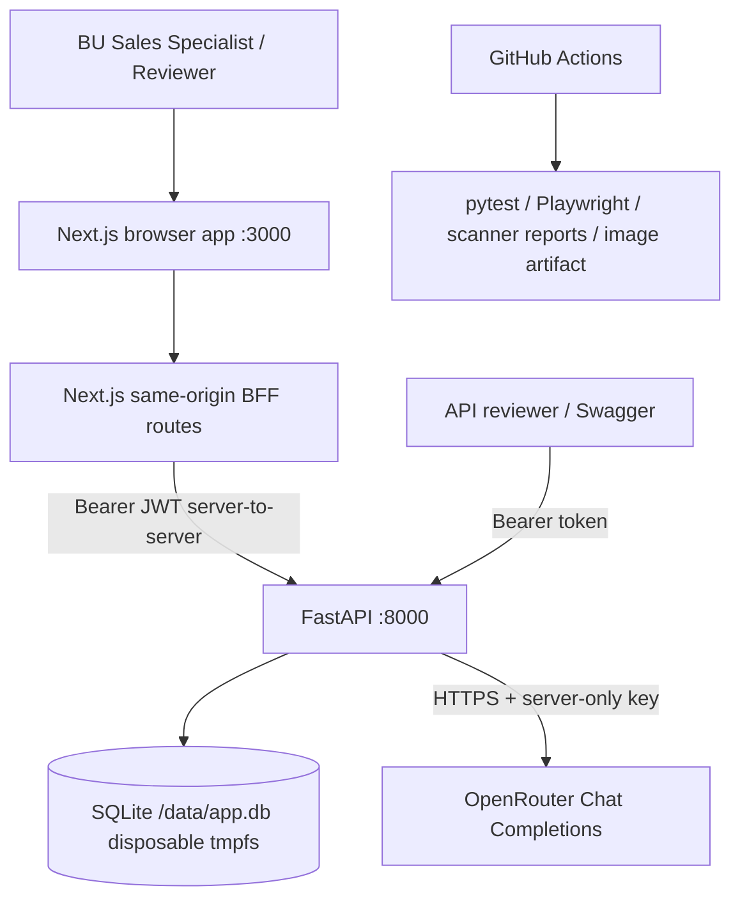

# ARCHITECTURE — AI Sales Support Hub

> R2 — Behavior amendment authorized by the User's approved repair plan, 14 October 2026. Original governing bytes and approval history are privately archived. This revision removes email registration, adopts disposable Docker state and retains existing auth/AI security boundaries.

## 1. Architecture driving requirements

Single-host demo: low concurrency, small catalog, one-command Compose, real external AI, secure auth, standard REST/Swagger, reproducible testing/scans. Strict drivers: OUT-001/002/003/004/005/006/007/008 and PRD-001..013. Assumed 100–1,000 products and one team (PRD-NFR-004), not a production scale target. Do not add queues, vector DB, Kubernetes, Redis, auth SaaS, microservices or cloud infra without approved requirement.

## 2. System context (diagram)



No browser-to-OpenRouter path. OpenRouter never receives the user password/token. `:8000` is exposed for Swagger/reviewer API exercise, but all product and suggestion routes remain bearer-protected.

## 3. Runtime and trust zones

```text
Browser (untrusted) :3000
  └─ Next.js UI + same-origin Route Handlers (BFF, cookie boundary)
       └─ Compose private network → FastAPI (JWT verify, Pydantic validation)
             ├─ /data/app.db on bounded Docker tmpfs
             └─ outbound HTTPS to OpenRouter
Reviewer: localhost:8000/docs → documented bearer-authorized API
CI: temporary Compose stack → test suites + scans → retained reports
```

- **ARCH-INV-001:** Every FastAPI protected API request validates a signed 3600-second JWT with the current random API-start epoch on the server (including calls that bypass Next.js).
- **ARCH-INV-002:** Browser JavaScript never reads bearer tokens or OpenRouter keys; BFF owns HttpOnly session cookie; state-changing BFF handlers verify `Origin` matching configured `APP_ORIGIN` (same-site cookie is not sufficient for all CSRF cases).
- **ARCH-INV-003:** Returned suggestion IDs must be a subset of the actual database candidate IDs; sanitize/validate external model JSON before response.
- **ARCH-INV-004:** Docker launch works after documented environment configuration with one command and disposable tmpfs; each API container start/restart resets data. No OpenRouter key is needed to serve CRUD; a real AI request without one fails explicitly.
- **ARCH-INV-005:** Review claims rely on executed observations with source identity; mocks cannot substitute for a live OpenRouter inference.
- **ARCH-INV-006:** Architecture HTML and Markdown carry the same core meaning and proposal revision; any semantic drift blocks approval.

## 4. Module and interface map

| Module | Owned paths | Responsibility | Contract / trust seam | PRD classes |
|---|---|---|---|---|
| MOD-001 Config/entry | `backend/app/main.py`, `backend/app/core/config.py`, `backend/app/db/session.py` | FastAPI app, startup, config, health, DB session and schema init | `GET /health`, local environment | CORE-002/004 |
| MOD-002 Auth service | `backend/app/core/security.py`, `backend/app/api/routes/auth.py`, `backend/app/api/deps.py`, `backend/app/schemas/auth.py` | Argon2id, JWT issuance, TTL and validation | `/api/auth/*`, Bearer | CORE-001 |
| MOD-003 Catalog service | `backend/app/db/models.py`, `backend/app/api/routes/products.py`, `backend/app/schemas/product.py`, `backend/app/seed.py` | Users and Products tables, REST CRUD, demo seed, field validation | `/api/products*`, SQLite | CORE-002 |
| MOD-004 Recommendation | `backend/app/api/routes/suggestions.py`, `backend/app/schemas/suggestion.py`, `backend/app/services/recommendation.py` | Candidate selection, prompt construction, allowlist checking | `POST /api/suggestions` | CORE-003 |
| MOD-005 OpenRouter adapter | `backend/app/services/openrouter.py` | HTTP timeout, provider JSON, error translation, explicit AI status | `POST /api/v1/chat/completions` external | CORE-003 |
| MOD-006 Web auth/BFF | `web/src/app/api/auth/**`, `web/src/app/api/backend/[...segments]/route.ts`, `web/src/lib/session.ts`, `web/src/app/(app)/layout.tsx` | Cookie, Origin check, reverse proxy whitelisting, server-side page guard | same-origin `/api/*` | CORE-001/002/003 |
| MOD-007 Product Web | `web/src/app/(app)/products/page.tsx`, `web/src/components/ProductForm.tsx`, `web/src/components/ProductTable.tsx`, `web/src/lib/api.ts` | CRUD UX and typed client | BFF REST | CORE-002 |
| MOD-008 Search Web | `web/src/app/(app)/search/page.tsx`, `web/src/components/RecommendationResults.tsx` | Natural-language search, loading/empty/error/result | BFF REST | CORE-003 |
| MOD-009 Delivery/CI | `compose.yaml`, Dockerfiles, `.github/workflows/ci.yml`, scan tooling | Compose, build/test/scans, artifact | Docker + GitHub Actions | CORE-004/005/006 |
| MOD-010 Evidence/Pitch | `README.md`, `docs/presentation/PITCH.md`, `docs/verification/EVIDENCE-MATRIX.md` | setup, outputs, 10m speaking plan | reviewer/manual proof | CORE-007 |
| MOD-011 Visual refinements | `web/src/app/globals.css`, existing UI styles | purely cosmetic accessible polish within approved behavior | DOM labels cannot regress | MINOR-001 |

## 5. Database schema and ownership

- `User(id: int PK, username: str unique, password_hash: str, created_at)`; trimmed lowercase username comparisons; registration confirms passwords; no plaintext password storage.
- `Product(id: int PK, name, brand, description, image_url, category, type, subtype, created_at, updated_at)`; required strings validated with Pydantic; `description` minimum 10 chars; url optional display link or string validated as HTTPS URL (no server-side URL fetch).
- SQLite DB URL `sqlite:////data/app.db`, SQLAlchemy session per request, Docker tmpfs `/data:rw,noexec,nosuid,nodev,size=64m,uid=10001,gid=10001,mode=0700`; one API worker to limit SQLite locking. Small index on product name/category. Schema and demo catalog initialized on each new ephemeral container filesystem for demo; migrations are later-scale work.
- Seed ten explicitly fictional products via an **idempotent** seed function only when catalog is empty, avoiding overwriting user CRUD. Delete action is hard-delete with confirmation dialog, adequate for disposable demo; no undelete promise.
- Catalog shared among authenticated BU staff users; no per-product ownership or role model in MVP. This is an explicit assumption, not an enterprise RBAC design.

## 6. Request sequences and failure branches

### 6.1 Register/Login/Auth

1. Browser POST `/api/auth/register` to same-origin BFF; route forwards validated JSON to FastAPI register. Backend hashes Argon2id and persists unique account, returns 201 or validation/conflict status.
2. Browser POST `/api/auth/login` with username/password to BFF; BFF forwards to backend; backend verifies hash, signs JWT exp=issued+3600s with the current API-start epoch. BFF writes HttpOnly, SameSite=Lax, `Secure` when HTTPS, bounded Max-Age cookie. Browser receives a safe session response, not the bearer token itself.
3. Protected UI layout checks cookie presence and directs to Login if missing; protected BFF checks cookie and Origin for mutating requests; backend verifies signed token on **every** protected call. `GET /api/auth/me` confirms session validity on demand. Logout clears cookie.
4. Invalid/bad/expired signature => backend 401; BFF relays sanitized 401 and UI prompts login. No secret leaks in logs.

### 6.2 Product CRUD

Browser → `/api/backend/products[/id]` → BFF whitelist+cookie+Origin guard → FastAPI `/api/products[/id]` → SQLAlchemy SQLite → DTO. Validate required fields and user status; 401 unauthenticated, 422 validation, 404 unknown ID; respond with predictable REST statuses.

### 6.3 Recommendation

Browser query → same-origin BFF → FastAPI protected route → fetch catalog → deterministic case-insensitive token-overlap shortlist (cap 20; when zero overlap, use first 20 as conservative fallback candidates) → OpenRouter HTTPS JSON-ranking request with candidate IDs and non-sensitive fields → Pydantic parse → IDs allowlisted against current shortlist → top 3 with reasons. Product fields in response are loaded from DB, not accepted from LLM. Empty catalog => 200 `suggestions: []` with notice; no API key/provider 429/timeout/malformed JSON => 503 `{code: "AI_UNAVAILABLE",message}` and no fake AI-success cards. Model configurable via `OPENROUTER_MODEL`; provider URL configurable for test seam but production default is official OpenRouter API.

### 6.4 Docker / CI

Reviewer configures local `.env` according to `.env.example` (JWT key required; OpenRouter key optional only for startup), then invokes `docker compose up --build --force-recreate` once. Services `web` and `api` share Compose network; `web` uses `BACKEND_INTERNAL_URL=http://api:8000`, API listens 0.0.0.0:8000, Web listens :3000. SQLite is disposable: API container stop/restart/recreation clears accounts and edits. Re-up initializes zero users and ten demo products. A no-op up leaves a running API unchanged. Explicit documented volumes/healthchecks. `api` may have a health status earlier than Web; Web startup should not depend on OpenRouter availability.

GitHub Actions jobs: Python Pytest, Next type/lint, integration Playwright with isolated mock-provider fixture, docker image build artifact, SCA (pip-audit/npm audit), SAST (Semgrep), IaC (Checkov), DAST (ZAP baseline against ephemeral started app). Upload reports even when scans produce findings; set actionable failure policy instead of swallowing exit codes. The ZAP baseline scope is documented (passive/unauthenticated by default); do not call that authenticated comprehensive DAST.

## 7. Security, abuse and bottleneck review

| Risk/failure | Boundary | Mitigation / result | Relevant test |
|---|---|---|---|
| Client forges JWT | BFF/FastAPI | Server signature/expiry verification, backend 401 | TEST-003/004/005 |
| CSRF against cookie | BFF POST/PUT/DELETE | `Origin == APP_ORIGIN`, SameSite Lax, JSON content, no wildcard CORS | TEST-006 |
| Prompt injection asks unknown products | External OpenRouter | ID whitelist + DB hydrator; ignore model-supplied product fields | TEST-011 |
| External provider unavailable | Backend OpenRouter HTTP | strict timeout, bounded error, fail non-success | TEST-012 |
| High concurrent write | SQLite DB | single instance demo; note production migration to PostgreSQL | TEST-010 |
| SSRF via image URL | Browser product fields | display URL only; no backend image download | TEST-009 |
| Secrets in bundles | Repo/CI | `.gitignore`, CI secret handling, redact logs | TEST-023 |
| Scanners misinterpreted | CI/evidence | report severity, scope, exit, unsatisfied coverage | TEST-019 |

Major throughput bottlenecks: SQLite concurrent writes, network LLM latency/cost, purely lexical shortlist. Mitigate through low-concurrency assumption, request timeout/clear UI, cap shortlist; revisit after actual needs or performance evidence. Do not claim scale without measurements.

## 8. Repository paths / deployment files (proposed)

```text
compose.yaml
.env.example
.gitignore
README.md
backend/pyproject.toml
backend/Dockerfile
backend/app/{main.py,seed.py}
backend/app/core/{config.py,security.py}
backend/app/db/{session.py,models.py}
backend/app/api/{deps.py,routes/{auth.py,products.py,suggestions.py}}
backend/app/schemas/{auth.py,product.py,suggestion.py}
backend/app/services/{recommendation.py,openrouter.py}
backend/tests/{conftest.py,test_auth.py,test_products.py,test_suggestions.py,test_openrouter_adapter.py}
web/{package.json,package-lock.json,tsconfig.json,next.config.ts,Dockerfile,playwright.config.ts}
web/src/app/{layout.tsx,globals.css,page.tsx,register/page.tsx,login/page.tsx}
web/src/app/(app)/{layout.tsx,products/page.tsx,search/page.tsx}
web/src/app/api/auth/{register/route.ts,login/route.ts,logout/route.ts}
web/src/app/api/backend/[...segments]/route.ts
web/src/lib/{api.ts,session.ts}
web/src/components/{ProductForm.tsx,ProductTable.tsx,RecommendationResults.tsx}
web/tests/e2e/{auth.spec.ts,catalog.spec.ts,search.spec.ts}
tests/fixtures/openrouter_mock.py
compose.e2e.yaml
.github/workflows/ci.yml
docs/presentation/PITCH.md
docs/verification/EVIDENCE-MATRIX.md
```

Concrete artifact names are plan-execution targets, not code already written. Additional required package scaffold files must be enumerated before the initial Code-create approval; no unnamed generated files may be treated as authorized.

## 9. Classification / architecture trace map

| Classes from PRD | Main modules | Key invariants | Verification cases |
|---|---|---|---|
| CORE-001 | MOD-002/MOD-006 | ARCH-INV-001/002 | TEST-001..007, TEST-014/015 |
| CORE-002 | MOD-001/003/007 | ARCH-INV-001/004 | TEST-008..010, TEST-016 |
| CORE-003 | MOD-004/005/008 | ARCH-INV-003/005 | TEST-011..013, TEST-017/018/024 |
| CORE-004 | MOD-001/009 | ARCH-INV-004 | TEST-020/021 |
| CORE-005 | MOD-009 | ARCH-INV-005 | TEST-001..018, TEST-022 |
| CORE-006 | MOD-009 | ARCH-INV-005 | TEST-019/022/023 |
| CORE-007 | MOD-010 | ARCH-INV-005 | TEST-025/026 |
| MINOR-001 | MOD-011 | ACCESSIBILITY preserved | TEST-015..018 regression |

## 10. Deployment tradeoffs and future migration

- **Why SQLite?** single Compose deployment; downside single writer; migrate with tests/schema export to PostgreSQL only if real team workload warrants.
- **Why BFF?** protects browser token and same-origin flow; downside extra Node handler layer requiring explicit CSRF check.
- **Why hybrid selection?** known-record grounding and manageable token budgets; lexical recall imperfect and demonstrated as such.
- **Why no cloud?** original specification asks Docker and Git URL, not external hosting. No claim of prod SLO/HA.
- **Rollback:** during demo revert to last Git commit and rebuild; preserve the private recovery backup; runtime SQLite is disposable. DB schema changes/destructive migration need separate approved safety plan; `down -v` is explicitly destructive and is not a normal teardown step.

## 11. Architecture approval checklist

Confirm all mapped modules exist only as proposals, the PRD classification is unchanged, two Architecture views contain equivalent content, the trust/CSRF/provider cases are TEST-covered, and the eventual Plans enumerate every owned path. Differences between PRD's proposed ADR and this Architecture must trigger a PRD amendment first.
